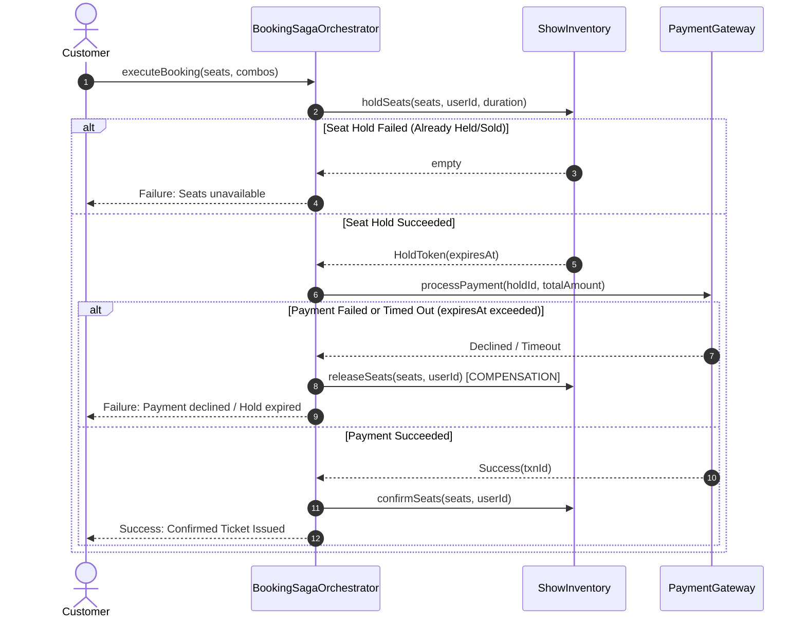

# Movie Ticket Booking System (BookMyShow-Style)
**Course:** Advanced Object-Oriented Programming (AOOP)  
**Section:** A7 | **Group:** G13  
**Repository:** [A7_AOOP_G13_PROJ](https://github.com/karanamabhinaysai-gif/A7_AOOP_G13_PROJ.git)

---

## 📌 Project Overview
A production-grade, highly concurrent, modular Movie Ticket Booking System inspired by BookMyShow. The architecture implements strict Domain-Driven Design (DDD) bounded contexts, robust object-oriented design patterns, contract-driven validation, and a multi-step distributed saga with compensating actions.

---

## 🏛️ Architecture & Bounded Contexts (U7)

The system is decomposed into four distinct, loosely coupled bounded contexts:

```mermaid
flowchart TD
    subgraph CatalogContext ["1. Catalog Context (com.bookmyshow.catalog)"]
        Movie["Movie (Title, Rating, Duration)"]
        Cinema["Cinema (Name, City)"]
        Screen["Screen (Layout Grid)"]
        CatalogService["Catalog Service"]
    end

    subgraph InventoryContext ["2. Show Inventory Context (com.bookmyshow.inventory)"]
        Show["Show (ShowId, StartTime, Screen)"]
        ShowSeat["ShowSeat (Lock & State)"]
        ShowInventory["ShowInventory (Aggregate Root)"]
        SeatState["Seat State Machine (Free, Held, Sold)"]
        SeatCat["Sealed SeatCategory Hierarchy"]
    end

    subgraph BookingContext ["3. Booking Context (com.bookmyshow.booking)"]
        Saga["BookingSagaOrchestrator"]
        Combos["Food & Combo Decorators"]
        TicketGen["Ticket Issuance"]
        PricingStrat["Dynamic Pricing Strategies"]
    end

    subgraph PaymentsContext ["4. Payments Context (com.bookmyshow.payments)"]
        Gateway["PaymentGateway (Interface)"]
        Tx["Idempotent PaymentResult"]
    end

    CatalogService --> Show
    Saga --> ShowInventory
    Saga --> PricingStrat
    Saga --> Combos
    Saga --> Gateway
    Saga --> TicketGen
```



1. **Catalog Context (`com.bookmyshow.catalog`):** Manages static entities: `Movie`, `Cinema`, `Screen`, and their querying via `CatalogService`.
2. **Show Inventory Context (`com.bookmyshow.inventory`):** Manages dynamic show instances, seat layouts, seat lifecycle state machines, fine-grained locks, and contracts.
3. **Booking Context (`com.bookmyshow.booking`):** Houses the Saga Orchestrator, dynamic pricing, add-on food combos (decorators), and finalized ticket generation.
4. **Payments Context (`com.bookmyshow.payments`):** Manages external payment gateway integrations, transactions, idempotency, and timeout detection.

---

## 🎯 Implementation Units Breakdown

### U1–2: Domain Primitives & Single-Sale Invariant
* **Immutable Domain Primitives:**
  - `ShowId`: Strongly typed, non-blank show identifier.
  - `SeatId`: Strongly typed row and number (e.g. `A1`, `B4`). Implements `Comparable<SeatId>` for canonical sorting.
  - `Money`: Precise decimal representation with currency safety, rounding, and arithmetic validation.
* **Single-Sale Invariant:** A seat within a given `ShowId` can be transitioned to `SOLD` **at most once**. Any secondary attempt to hold or confirm a sold seat throws an `IllegalStateException` and is strictly rejected.

### U3: Contracts on `holdSeats` & Sealed `SeatCategory`
* **Method Preconditions:**
  - `requestedSeats` must not be null or empty, and must belong to the show layout.
  - `userId` must not be null or blank.
  - `holdDuration` must be strictly positive (`> 0`).
* **Expiry Postcondition:**
  - Returns a cryptographically unique `HoldToken` with `expiresAt = now + holdDuration`.
  - If confirmation and payment are not completed before `expiresAt`, the hold expires and the seat becomes available to other users.
* **Sealed `SeatCategory` Hierarchy:**
  ```java
  public sealed interface SeatCategory permits SilverSeat, GoldSeat, PlatinumSeat, ReclinerSeat {
      String name();
      Money basePrice();
      String description();
  }
  ```

### U4: Core Design Patterns
1. **State Pattern (`SeatState`):**
   - **`FreeState`:** Seat is available for holding.
   - **`HeldState`:** Seat is temporarily reserved for a user until `expiresAt`. If `now.isAfter(expiresAt)`, it becomes available.
   - **`SoldState`:** Terminal state. Immutable and non-releasable.
2. **Strategy Pattern (`PricingStrategy`):**
   - **`StandardPricingStrategy`:** Charges category base price.
   - **`WeekendPricingStrategy`:** Applies weekend surge multiplier (e.g., 25%).
   - **`DemandSurgePricingStrategy`:** Dynamically scales ticket price (up to +50%) based on live occupancy rate (>80% occupancy).
3. **Decorator Pattern (`BookingItemDecorator`):**
   - Base component: `SeatTicketItem`
   - Concrete decorators: `PopcornDecorator`, `CokeDecorator`, `NachosDecorator`. Dynamically adds descriptions and accumulates combo costs without mutating core ticket logic.

### U5: Hold → Pay → Confirm Saga Orchestrator
Coordinates multi-step transaction with automated compensating actions:


### U6: Concurrent Seat Holds for First-Day-First-Show (FDFS) Rush
To handle thousands of concurrent requests competing for the exact same seats:
1. **Deadlock Elimination via Canonical Sorting:**
   Seats in every hold request are sorted in canonical lexicographical order (`A1, A2, B1...`) before acquiring fine-grained per-seat `ReentrantLock`s. This guarantees identical lock acquisition ordering across all threads, eliminating circular wait (dining philosophers problem).
2. **Atomic All-or-Nothing Hold:**
   All requested seats are verified for availability. If even a single seat is unavailable, no seats are held, and all locks are released cleanly.
3. **Thread Fairness:**
   Fair reentrant locks (`new ReentrantLock(true)`) ensure first-come-first-served fairness during burst surges.

---

## 🚀 Running the Project

### Prerequisites
- **Java Development Kit (JDK 17 or higher)**
- **Git**

### 1. Run Automated Unit & Invariant Tests
Verifies all 36 contract, invariant, pattern, and concurrency assertions:
```bash
# Windows
test.bat

# Linux / macOS
chmod +x test.sh
./test.sh
```

### 2. Run the Main Interactive Demonstration
Simulates movie setup, dynamic pricing, food combos, failed payment compensation, and a 10-thread simultaneous rush:
```bash
# Windows
run.bat

# Linux / macOS
chmod +x run.sh
./run.sh
```

### 3. Build & Run via Maven (Optional)
```bash
mvn clean compile
mvn exec:java -Dexec.mainClass="com.bookmyshow.app.Main"
```

---

## 🧪 Test Suite Coverage Summary

| Unit | Test Case | Status |
| :--- | :--- | :--- |
| **U1–U2** | Value Objects immutability & arithmetic validation | `PASSED` |
| **U1–U2** | Single-sale invariant (cannot confirm/sell a sold seat) | `PASSED` |
| **U3** | Precondition contracts on empty list / blank user ID | `PASSED` |
| **U3** | Expiry postcondition on hold token timestamp | `PASSED` |
| **U3** | Sealed hierarchy completeness for `SeatCategory` | `PASSED` |
| **U4** | State Pattern: transitions across `Free`, `Held`, `Sold` | `PASSED` |
| **U4** | Strategy Pattern: standard vs. surge pricing based on occupancy | `PASSED` |
| **U4** | Decorator Pattern: chaining Popcorn, Coke, and Nachos | `PASSED` |
| **U5** | Saga: Happy path (`Hold` -> `Pay` -> `Confirm`) | `PASSED` |
| **U5** | Saga: Compensating rollback on payment decline | `PASSED` |
| **U5** | Saga: Compensating rollback on hold expiration/timeout | `PASSED` |
| **U6** | High-concurrency race condition test (16 threads for 1 seat) | `PASSED` |
| **U7** | Bounded contexts decoupling & isolation | `PASSED` |
